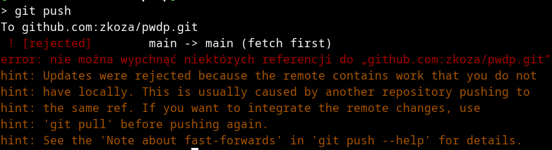

# Git

## 5. Git a praca w zespole

Praca w zespole to domyślny tryb pracy w środowisku git. Mam ona pewną bardzo charakterystyczną specyfikę, którą nieco żartobliwie nazwałbym tendencją do występowania zjawiska znanego w informatyce jako [wyścig](https://en.wikipedia.org/wiki/Race_condition#In_software) (*nota bene*, nie mogę pojąć, że tak ważne pojęcie nie jest opisane w polskiej Wikipedii w kontekście oprogramowania komputerowego – październik 2026). Wyścig to zjawisko polegające na tym, że co najmniej dwa niezależne „byty”, np. programy, wątki programów, agenci AI, ludzie – usiłują jednocześnie modyfikować ten sam zasób, nie mając „świadomości”, że robią to (w pewnym sensie) jednocześnie. W przypadku git-a tym zasobem jest po prostu repozytorium. Chodzi o to, że jeżeli w zespole pracuje co najmniej kilka osób, to nie można odseparować zasobów (tu: po prostu plików), które twórcy oprogramowania mogą podczas wykonywania swoich zadań modyfikować. Te same osoby mogą w tym samym czasie chcieć zmienić zawartość tych samych plików, nie wiedząc o sobie nic nawzajem. Jak rozstrzygnąć, czyja zmiana jest ważniejsza? Jak w ogóle włączyć te pozornie chaotycznie wykonywane zmiany do głównego repozytorium tak, by nie wprowadzić do niego błędów?

Rozpoczną od scenariusza podstawowego, z którym początkujący użytkownik git-a styka się najczęściej: konflikt przy próbie wykonania operacji `git pull` (czyli ściągnięcia na swój komputer aktualnej wersji zdalnego repozytorium).

### 5.1. Konflikt podczas operacji `git pull`

Jeżeli operacja `git pull` nie może dojść do skutku, to zwykle dlatego, że ktoś zmienił zawartość repozytorium w taki sposób, że jego pobranie na nasz komputer nadpisałoby zmiany, które sami niedawno zrobiliśmy. W takim przypadku mamy tzw konflikt (a raczej konflikty, bo zwykle takich konfliktujących zmian jest wiele) . Mamy teraz dwa przypadki: łatwy (rozwiązanie konfliktów można zautomatyzować) i nieco trudniejszy (rozwiązanie konfliktów wymaga decyzji człowieka).

#### 5.1.1. Konflikty rozwiązywane automatycznie

Przypuśćmy, że będąc w pracy, zmieniłem w tym pliku którego zawartość właśnie czytasz, tytuł z „Git” na „Git jest git” i zapisałem tę zmianę na serwerze – np. edytując ten plik bezpośrednio na serwerze. Jednocześnie po przyjściu do domu zapomniałem o tym i dopisałem jakiś tekst na końcu. Następnie, cały czas pracując na domowym komputerze, próbuję te zmiany zapisać na serwer. Efekt jest jak na rysunku poniżej:

Git komunikuje, że nie może wykonać operacji `git push`, gdyż zdalne repozytorium zawiera zmiany, których nie ma w repozytorium lokalnym. Sugeruje też, by wykonać `git pull` a dopiero później `git push`.    Próbujemy:

Ciąg dalszy nastąpi…. 

 

 