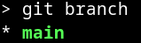
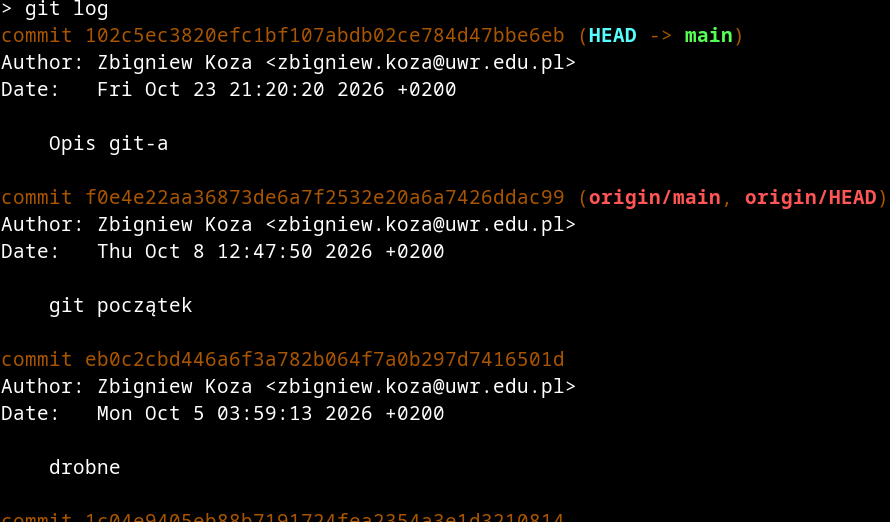

# Git

## 3. Podstawy pracy z repozytorium lokalnym

### 3.1. Wprowadzenie

Załóżmy, że za pomocą `git init` lub `git clone` utworzyliśmy w swoim komputerze repozytorium lokalne.  Od tej chwili możemy w nim w dotychczasowy sposób dodawać nowe pliki (i katalogi) oraz modyfikować bądź usuwać pliki istniejące. Nie będzie to miało żadnego wpływu na stan repozytorium lokalnego. Ten stan możemy zmienić wyłącznie poprzez komendy programu `git`. Ich podstawowa składnia jest prosta:

```txt
git <komenda> [-opcja] ... [-opcja] [--opcja] ... [--opcja] [argument_1] [argument_2] ... [argument_n]
```

Czyli polecenie git wymaga podania komendy (np. `add`) i opcjonalnej listy opcji (rozpoznajemy je po jednym lub dwóch dywizach na początku ich nazwy) oraz równie opcjonalnej listy argumentów. Zwyczajowo opcje z jednym dywizem to formy skrócone, jednoliterowe, np. `git -h`  to to samo co `git --help`. 

### 3.2. Komendy niemodyfikujące repozytorium 

Zaczniemy od rzeczy najłatwiejszych i najbezpieczniejszych:  komend systemu `git` służących do uzyskiwania informacji o stanie repozytorium, w tym o jego historii. Do najważniejszych należą:

- `git log`
- `git status`
- `git diff`
- `git config list`

Kilka przykładów ich zastosowania na repozytorium, które w tej chwili czytasz:

- `git log`:
  
  Komenda ta wyświetla listę dostępnych migawek wraz z ich krótkim opisem. Widzimy, kto jest autorem każdej z nich i kiedy została dodana do repozytorium. Widzimy też skróty SHA1 każdej z nich (ciągi znaków szesnastkowych po słowie „commit”). Widzimy też, że do ostatniej z migawek można się odwołać za pomocą „wskaźników” / „referencji” `HEAD` (na gałęzi `main`), `origin/main` oraz `origin/HEAD`. Powyższy zrzut ekranu przedstawia tylko niewielki wycinek logu tego repozytorium – dwa wpisy z trzydziestu siedmiu. 

- `git status`:

  

  Widzimy, że do indeksu dodano dotąd jeden plik: `cpp/w11/sfml30/sfml.cpp`. Od utworzenia poprzedniej migawki zmieniono 4 pliki, w tym `000-git.md`, czyli plik, który w tej chwili czytasz. W obszarze roboczym znajduje się też sporo plików nieśledzonych, a nawet całe katalogi. Jednym z nich jest `img/00`, w którym znajdują się obrazki wyświetlane na tej stronie.

- `git diff`. 

  Polecenie `git status` poinformowało nas, że od czasu utworzenia ostatniej migawki, w naszym projekcie zmianie uległ m.in. plik `pgm0.cpp` znajdujący się w podkatalogu `cpp/w04/pgm/`. Aby sprawdzić, co to za zmiany, wystarczy wydać polecenie `git diff cpp/w04/pgm/pgm0.cpp`:

  

  Tutaj zmiany zaznaczone są kolorem: wiersze dodane wyświetlane są na zielono (i są poprzedzone znakiem `+`), wiersze usuwane – na czerwono (poprzedzone są znakiem `-`, a wiersze niezmienione - na biało. Dodatkowo niektóre wiersze zaczynają się od pary wyświetlanych na niebiesko znaków `@`, po których znajdują się pewne liczby. Jest to informacja o zmianach zapisana w formacie [Universal diff](https://en.wikipedia.org/wiki/Diff#Unified_format).

- `git config list`:

  

  Ta opcja pozwala zorientować się w aktualnej konfiguracji repozytorium. Na powyższym zrzucie ekranu najważniejsze są informacje na końcu tej listy: repozytorium połączone jest z serwisem GitHub (a nie np. Codeberg).

- `git branch` – ta komenda wyświetla wszystkie gałęzie repozytorium, gałąź bieżącą wyróżniając gwiazdką w pierwszej kolumnie oraz zielonym kolorem: 

  

### 3.3. Komendy modyfikujące indeks

Najczęściej wykorzystywanym poleceniem z grupy poleceń modyfikujących indeks jest `git add`. 

### 3.3.1. `git add`

Przypuśćmy, że chcemy przygotować do utrwalenia w postaci migawki zmiany w pliku, który czytasz. W tym celu wydajemy polecenie

```txt
> git add 000c-praca-z-repo-lokalnym.md
```

Dodaje ono do indeksu plik `000c-praca-z-repo-lokalnym.md` w jego bieżącym stanie. Jedną komendą można dodać do indeksu kilka plików naraz, np. poniższa komenda dodaje do indeksu 4 pliki:

```   txt
> git add 000c-praca-z-repo-lokalnym.md 000a-wstep.md 000b-repozytorium.md 000-git.md
```

**UWAGA!!!** 

Do repozytorium dodajemy wyłącznie niezbędne pliki z kodem programu i ewentualnie inne, bez których programu nie da się skompilować lub uruchomić. Mogą to więc być pliki z grafikami, dźwiękami, czcionkami itp. Nie dodajemy do indeksu (i repozytorium) plików pośrednich kompilacji ani plików wykonywalnych.   

### 3.3.2. `git mv`

Polecenie `git mv` służy do zmiany nazwy pliku lub katalogu (lub do przeniesienia pliku do innego katalogu). Wymaga ono dwóch argumentów: nazwy pliku źródłowego i nazwy docelowej, np. polecenie 

```txt 
git mv plik.txt plik.cpp
```

zamieniłoby nazwę pliku `plik.txt` na `plik.cpp`.

### 3.3.3. `git rm`

Polecenie `git rm` służy do usuwania pliku – zarówno z kolejnej migawki, jak i katalogu roboczego. Oczywiście nie można go usunąć z tych migawek, w których został utrwalony. Przykład:

```txt
git rm program.exe
```

### 3.4. Komendy modyfikujące repozytorium

W zasadzie (o ile mi wiadomo) istnieje tylko jedna taka komenda: `git commit`. Powoduje ona utworzenie migawki na podstawie aktualnej zawartości indeksu. Zwykle towarzyszy jej opcja `-m` służąca do dodania do tworzonej właśnie migawki krótkiej informacji ją opisującej. 

```bash  
git commit -m"Opis git-a"
[main 102c5ec] Opis git-a
 5 files changed, 287 insertions(+), 33 deletions(-)
 create mode 100644 000a-wstep.md
 create mode 100644 000b-repozytorium.md
 create mode 100644 000c-praca-z-repo-lokalnym.md
```

Jak widać, w przypadku tego konkretnego polecenia `git commit`, git utworzył nową migawkę o identyfikatorze zaczynającym się od ciągu liter szesnastkowych `102c5ec` na gałęzi `main`. W wyniku tej operacji, zmienianie uległo 5 plików, z czego 3 to pliki dotąd niewystępujące w repozytorium. 

Sprawdźmy historię zmian za pomocą polecenia `git log` (obrazek przedstawia 3 najnowsze wpisy):

  

Faktycznie, klucz SHA-1 najnowszej migawka rozpoczyna się od znaków `102c5ec`, a migawka ta opatrzona jest komentarzem „Opis git-a”.

Warto zwrócić uwagę na to, że wskaźnik `HEAD` przesunął się automatycznie do najnowszej migawki na bieżącej gałęzi, którą jest `main`.  Jednocześnie analogiczne wskaźniki dla zdalnego serwera, `origin/main` i `origin/HEAD`, pozostały w dotychczasowym miejscu. Taka sytuacja występuje wtedy, gdy od czasu ostatniej synchronizacji z serwerem utworzyliśmy jakieś migawki lokalne. Stany lokalnego i zdalnego serwera są różne. Musimy jakoś poinformować zdalny serwer o dokonanej właśnie zmianie repozytorium polegającej na utworzeniu nowej migawki (lub całej serii migawek, być może na różnych gałęziach).

​    


   

 

 


