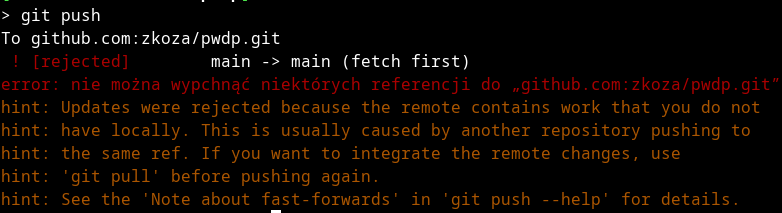

# Git
## 5. Git a praca na wielu maszynach

Praca w zespole na wielu komputerachto domyślny tryb pracy w środowisku git. Mam ona pewną bardzo charakterystyczną specyfikę, którą nieco żartobliwie nazwałbym tendencją do występowania zjawiska znanego w informatyce jako [wyścig](https://en.wikipedia.org/wiki/Race_condition#In_software) (*nota bene*, nie mogę pojąć, że tak ważne pojęcie nie jest opisane w polskiej Wikipedii w kontekście oprogramowania komputerowego – październik 2026). Wyścig to zjawisko polegające na tym, że co najmniej dwa niezależne „byty”, np. programy, wątki programów, agenci AI, ludzie – usiłują jednocześnie modyfikować ten sam zasób, nie mając „świadomości”, że robią to (w pewnym sensie) jednocześnie. W przypadku git-a tym zasobem jest po prostu repozytorium. Chodzi o to, że jeżeli w zespole pracuje co najmniej kilka osób, to nie można odseparować zasobów (tu: po prostu plików), które twórcy oprogramowania mogą podczas wykonywania swoich zadań modyfikować. Te same osoby mogą w tym samym czasie chcieć zmienić zawartość tych samych plików, nie wiedząc o sobie nic nawzajem. Jak rozstrzygnąć, czyja zmiana jest ważniejsza? Jak w ogóle włączyć te pozornie chaotycznie wykonywane zmiany do głównego repozytorium tak, by nie wprowadzić do niego błędów?

Rozpocznę od scenariusza najprostszego, w którym pracujemy nad tym samym projektem, używając różnych maszyn (np. prywatnego laptop i jednego lub może nawet kilku komputerów uczelnianych). W tym wariancie początkujący użytkownik git-a styka się najczęściej z następującym problemem: git zgłasza komunikat o błędzie (konflikt różnych wersji repozytorium) podczas próby wykonania operacji `git pull` (czyli ściągnięcia na swój komputer aktualnej wersji zdalnego repozytorium).

### 5.1. Konflikt podczas operacji `git pull`

Jeżeli operacja `git pull` nie może dojść do skutku, to zwykle dlatego, że ktoś zmienił zawartość repozytorium w taki sposób, że jego pobranie na nasz komputer nadpisałoby zmiany, które sami niedawno zrobiliśmy. W takim przypadku mamy tzw konflikt (a raczej konflikty, bo zwykle takich konfliktujących zmian jest wiele) . Mamy teraz dwa przypadki: łatwy (rozwiązanie konfliktów można zautomatyzować) i nieco trudniejszy (rozwiązanie konfliktów wymaga decyzji człowieka).

#### 5.1.1. Konflikty rozwiązywane automatycznie

Przypuśćmy, że będąc w pracy, zmieniłem w tym pliku którego zawartość właśnie czytasz, tytuł z „Git” na „Git jest git” i zapisałem tę zmianę na serwerze – np. edytując ten plik bezpośrednio na serwerze. Jednocześnie po przyjściu do domu zapomniałem o tym i dopisałem jakiś tekst na końcu. Następnie, cały czas pracując na domowym komputerze, próbuję te zmiany zapisać na serwer. Efekt jest jak na rysunku poniżej:



Git komunikuje, że nie może wykonać operacji `git push`, gdyż zdalne repozytorium zawiera zmiany, których nie ma w repozytorium lokalnym. Sugeruje też, by wykonać `git pull` a dopiero później `git push`.    Próbujemy. Po chwili otwiera się domyślny (dla git) edytor, a w nim komunikat

```txt 
Merge branch 'main' of github.com:zkoza/pwdp
# Podaj komunikat zapisu, żeby wyjaśnić, dlaczego to scalenie jest konieczne,
# zwłaszcza jeśli scala zaktualizowaną gałąź nadrzędną z gałęzią tematyczną.
#
# Lines starting with '#' will be ignored, and an empty message aborts
# the commit.
```

Oznacza on, że git przystępuje do automatycznego włączania zmian z repozytorium zdalnego do repozytorium lokalnego. Migawka, którą w tym celu utworzy, będzie typu „merge” (po polsku: „scalanie”). Taka migawka ma 2 przodków. W edytorze mamy przygotowany domyślny dla scalania komunikat „Merge branch 'main' of github.com:zkoza/pwdp” – cała reszta zostanie podczas scalania odrzucona. Możemy wstrzymać scalanie, kasując ten komunikat. Tym razem postanawiamy jednak dokończyć scalanie – w tym celu po prostu zapisujemy plik w bieżącej postaci. Git wyświetli nowy komunikat:


Oznacza on, że scalanie zakończyło się pomyślnie. Widzimy też, że zmiany objęły w pliki. W jednym dodano 18 wierszy i usunięto 3, w drugim dodano 1 wiersz i usunięto też 1 (liczba plusików i minusików jest proporcjonalna do liczby dodanych i usuniętych wierszy w każdym pliku). To wszystko. Zsynchronizowaliśmy zmiany uwidocznione w serwerze zdalnym z lokalnymi, tworząc nową migawkę. Możemy ją wepchnąć na serwer poleceniem `git push`. Aby teraz zobaczyć zmiany w repozytorium zdalnym za pomocą przeglądarki, zwykle należy odświeżyć jej widok.   

#### 5.1.2. Konflikty, które muszą być rozwiązywane ręcznie

W powyższym przykładzie zmiany na serwerze dotyczyły różnych miejsc tego samego pliku. Takie zmiany łatwo „rozwiązać” automatycznie. Prawdziwy problem („wyścig”) pojawia się, gdy zmiany dotykają tych samych wierszy naszych plików. Spróbujmy dokonać ponownej edycji pierwszego wiersza bieżącego pliku, na serwerze i lokalnie, za każdym razem inaczej zmieniając jego treść. Po próbie wykonania polecenia `git push` dostaniemy taki sam komunikat o błędzie jak poprzednio. Musimy więc najpierw włączyć zmiany z serwera do lokalnego repozytorium. Tym razem git nie jest w stanie automatycznie scalić różnic i otrzymujemy komunikat o błędzie:

```txt  
> git pull 
remote: Enumerating objects: 5, done.
remote: Counting objects: 100% (5/5), done.
remote: Compressing objects: 100% (3/3), done.
remote: Total 3 (delta 2), reused 0 (delta 0), pack-reused 0 (from 0)
Rozpakowywanie obiektów: 100% (3/3), 957 bajt | 957.00 KiB/s, gotowe.
Z github.com:zkoza/pwdp
   64eab3c..1d6774d  main       -> origin/main
Auto-scalanie 000c-praca-w-zespole.md
KONFLIKT (zawartość): Konflikt scalania w 000c-praca-w-zespole.md
Automatyczne scalanie nie powiodło się; napraw konflikty i złóż wynik.
```

Git radzi nam, by „naprawić konflikty” i później „złożyć wynik”. To drugie, „składanie wyniku”, to `git commit`, ale jak naprawić konflikty?

Spójrzmy najpierw na komunikat, jaki wyświetla polecenie `git status`:


Jak widać, znajdujemy się w fazie niedokończonego scalania („merge”), o czym świadczy komunikat „Masz niescalone ścieżki” oraz stan pliku `000c-praca-w-zespole.md`, określony tu jako „oba zmienione”. Jakie oba? Ano ten idący z serwera i ten lokalny. 

Pouczające jest sprawdzenie, jak w tej chwili wygląda plik, w którym stwierdzono istnienie konfliktu. Oto kilka pierwszych wierszy pliku :

```txt
<<<<<<< HEAD
# Git
=======
# Git jest bardzo git
>>>>>>> 1d6774d21c7c0e73a581b8a5320cb5b6aaae50b5
```

Reszta jego zawartości jest niezmieniona. O co w tym chodzi? Otóż git rozpoczął scalanie zmian, ale nie był w stanie ich dokończyć. Zostawił więc nasz plik w stanie, że tak powiem, „rozbabranym”, z którego jednak łatwo można odtworzyć zarówno jego stan sprzed zmian – zarówno lokalny, jak i zdalny. W powyższych 5 wierszach można wyróżnić 2 bloki tekstu i trzy ograniczniki. Tymi ogranicznikami są wiersze rozpoczynające się od znaków `<<<<<<<`, `=======` i `>>>>>>>`. Pierwszy blok, pomiędzy `<<<<<<<` i `=======` to nasza lokalna wersja fragmentu tekstu, którego nie można scalić automatycznie, a drugi blok, między `=======` i `>>>>>>>`, to wersja zdalna. Mamy więc pełny wgląd w obie wersje: lokalną i zdalną i musimy zdecydować, jak naprawdę powinien wyglądać dany fragment naszego pliku. 

W tym celu możemy pójść jedną z dwóch dróg: „ręczną” (w edytorze tekstu) lub „ze wspomaganiem” (w edytorze specjalistycznym).

##### 5.1.2.1. Rozwiązywanie konfliktów w zwykłym edytorze tekstu

Scalania można dokonać w zwykłym, najprymitywniejszym edytorze tekstu. W tym celu edytujemy zawartość pliku znajdującego się w stanie „oba zmienione” tak, aby przybrał on pożądaną postać. Następnie zatwierdzamy go poleceniem `git add`. Po tej komendzie git uznaje plik za scalony: możemy włączyć go do nowej migawki (`git commit`) itd. 

Innymi słowy, usuwamy całe wiersze ze znacznikami `<<<<<<<`, `=======` i `>>>>>>>` oraz zostawiamy tylko jeden z dwóch alternatywnych bloków, być może dokonując w nim jakichś dodatkowych edycji, po czym zatwierdzamy te zmiany poleceniem `git add`. To wszystko! Oczywiście powtarzamy tę procedurę z każdym niescalonym plikiem, a na koniec zatwierdzamy (i kończymy) scalanie poleceniem `git commit`, tworzącym nową migawkę w repozytorium. 

##### 5.1.2.1. Rozwiązywanie konfliktów w specjalistycznym edytorze tekstu

Zwykłe edytory tekstu nadają się do scalanie zmian małych i nielicznych. Co jednak, jeżeli w danym pliku ktoś dodał lub usunął, lub zmienił duże bloki kodu programu? Naprawdę jesteśmy w stanie szybko wychwycić okiem różnice między wersjami? Nie za bardzo. Dlatego powstały specjalne edytory wspomagające scalanie różnych wersji tego samego pliku. Ja używam programu `kdiff3` dostępnego dla systemów Linux. Inne popularne narzędzia tego typu to p4merge i Meld, a dla systemu Windows –  WinMerge. 

Narzędzie trzeba przed pierwszym użyciem skonfigurować do współpracy z systemem git

```txt
> git config --global merge.tool kdiff3
```

Od tej pory domyślnym narzędziem do scalania staje się `kdiff3`. Następnie wydajemy polecenie 

```txt
> git mergetool
```

które uruchamia nasz ulubiony edytor scalania z odpowiednimi opcjami i argumentami. W moim przypadku program `kdiff3` uruchamia się z następującym widokiem:


Przestrzeń robocza podzielona jest na 4 okienka:

- A (Podstawa, ang. *Base*)  – okienko w górnym rzędzie, pierwsze po lewej – przedstawia stan pliku w ostatniej migawce wspólnej dla naszej wersji pliku i wersji, z której wprowadzamy zmiany. 
- B (*Local*) – okienko w górnym rzędzie na środku – wyświetla plik w naszej wersji.  
- C (*Remote*) – ostatnie okienko w górnym rzędzie – wyświetla plik w wersji, która jest na serwerze. Ten plik bywa też nazywany umownie *theirs* (a nasz - *ours*). Scalanie automatyczne polegałoby na naniesieniu w pliku *ours* zmian względem *base* widocznych w pliku *theirs*.
- Wyjście (*Output*) to plik będący rezultatem scalenia.

Naszym zadaniem jest ustalenie treści w okienku `Wyjście` na podstawie zawartości okienek A (*Base*), B (*ours*) i C (*theirs*). Możemy to zrobić ręcznie lub posługując się przyciskami `A`, `B` lub `C`. 

Na koniec zapisujemy plik i wychodzimy z programu. 

Jeżeli poprawnie rozwiązaliśmy wszystkie konflikty, scalanie jest zakończone. Nie musimy scalanego pliku dodawać do indeksu komendą `git add` jak ma to miejsce w przypadku scalania w zwykłym edytorze. Sprawdźmy, co o stanie repozytorium mówi w tej sytuacji `git status`:

```txt
> git status
Na gałęzi main
Twoja gałąź i „origin/main” się rozeszły
i mają odpowiednio 1 i 1 różne zapisy.
  (use "git pull" if you want to integrate the remote branch with yours)

Wszystkie konflikty naprawione, ale wciąż trwa scalanie.
  (użyj „git commit”, żeby zwieńczyć scalanie)
```

Jak widać, konflikty zostały rozwiązane, ale scalanie nie zostało ukończone. Brakuje nam migawki, która zawierałaby wszystkie zmiany. Tworzymy ją w zwykły sposób, komendą `git commit` i „wypychamy” na serwer komendą `git push`:

```txt
> git commit 
[main c0b2aad] Merge branch 'main' of github.com:zkoza/pwdp
> git push 
Wymienianie obiektów: 8, gotowe.
Zliczanie obiektów: 100% (8/8), gotowe.
Kompresja delt z użyciem do 12 wątków
Kompresowanie obiektów: 100% (4/4), gotowe.
Zapisywanie obiektów: 100% (4/4), 1.70 KiB | 1.71 MiB/s, gotowe.
Total 4 (delta 2), reused 1 (delta 0), pack-reused 0 (from 0)
remote: Resolving deltas: 100% (2/2), completed with 2 local objects.
To github.com:zkoza/pwdp.git
   1d6774d..c0b2aad  main -> main
```


 

 

 
